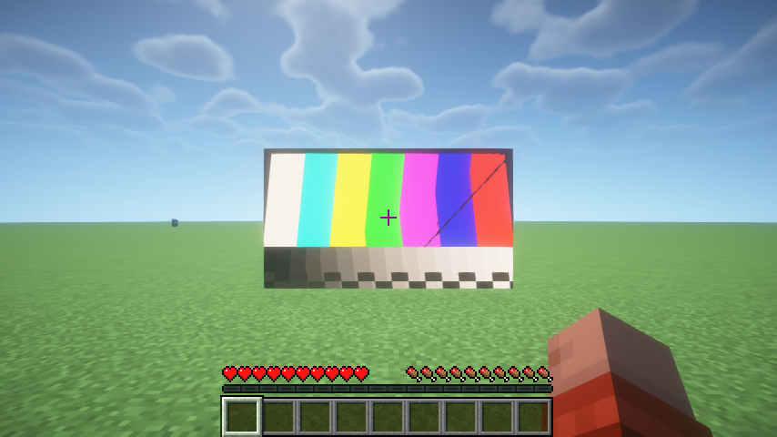
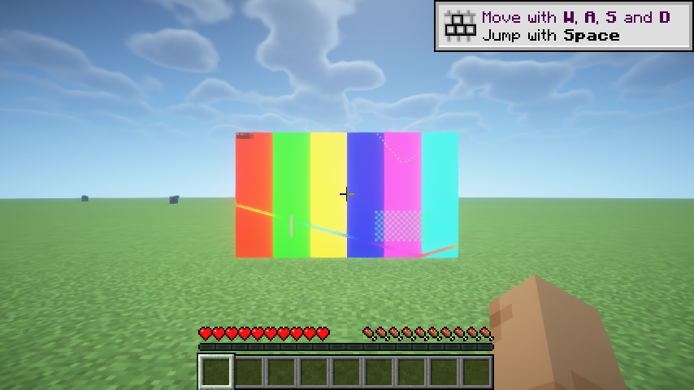

# Cinema P0.5：扬声器与投影仪设计/验证清单

> 目标不是“再做一个视频播放器”，而是把影院拆成几个真实的物理单元：
> 扬声器是独立的音频回放单元，投影仪是从镜头向世界投射光/图像的装置。
> 本文只讨论 P0.5 需要验证的东西和可选路线，不替代 P0 的播放管线结论。

## 1. 已经测到的硬事实

### 已锁定的产品方向

- 投影面：**专用屏幕方块**（第一版不做任意地形）。
- 扬声器：**5.1 架构**（FL/FR/FC/LFE/BL/BR），P1 同时保留立体声回退。
- 投影仪：**核心光学**——投掷比/变焦、对焦、梯形校正、遮挡阴影、
  环境光洗白、灯泡预热/风扇声。
- **可见光束已删除**（用户决定）：不做从镜头到屏幕的可见光锥/粒子束；
  画面仍然只投射到专用屏幕，遮挡阴影/环境光/灯泡效果保留。
- 新增 **AV 接收器方块**，主座位作为“皇帝位”/校准参考点。

### OpenAL（Windows，LWJGL 3.3.3 / OpenAL Soft 1.23.1）

| 能力 | 结果 | 对设计的影响 |
|---|---|---|
| EFX | 1.0，2 个 auxiliary send | 可做 1 个房间混响 + 1 个备用效果；不要假设无限 send |
| HRTF | 支持 | 可做耳机虚拟 5.1，但扬声器模式不应默认开 HRTF |
| `AL_EXT_SOURCE_RADIUS` | 支持 | 扬声器可设为有体积的声源，而不是一个点 |
| `AL_SOFT_source_latency` | 支持 | 能拿到“混音器位置 + 到 DAC 的延迟” |
| `ALC_SOFT_device_clock` | 支持 | 多扬声器可按同一个设备时钟启动 |
| `AL_SOFT_source_start_delay` | 支持 | `alSourcePlayAtTimeSOFT` 可做采样级同时启动 |
| `ALC_EXT_thread_local_context` | 支持 | 多线程下可安全切换 context |
| 双设备 + 双 context 同进程 | 通过 | 技术上可独立于 Minecraft 开第二套输出 |

### 关键修正

1. `AL_SEC_OFFSET` 是**当前队首 buffer 内**的偏移，换 buffer 会归零。
   媒体时间要用“队首 buffer 起点 + offset”。
2. `AL_SEC_OFFSET` 只到混音器。真实设备延迟本机 **50–60 ms**。
   视频目标必须用 `AL_SEC_OFFSET_LATENCY_SOFT` 减去延迟。
3. P0 最初的测试素材其实是**单声道**（`sine` 默认 mono）。已改成真实立体声，
   并新增 5.1 测试片；5.1 六声道解码顺序验证通过。
4. 同一 context 内 6 个 source 用同一设备时钟启动，实测 **0 sample skew**。
   EFX reverb、direct low-pass、source radius、cone 均可正常设置。

### 1.1 Minecraft 内独立 context（P0.5-A）

**通过。** 在真实客户端中打开独立 OpenAL device/context，播放 6 个 mono source：

- 六路 sample offset 完全一致：**0 samples / 0.000 ms skew**
- EFX/device clock/start delay 均可用
- 关闭独立 context 后，Minecraft `SoundEngine` 仍能正常请求 UI 音效，客户端正常退出
- 不调用 `ALC.destroy()`，避免破坏 Minecraft 共享的 LWJGL OpenAL 函数指针

结论：第一版可以走**独立 context**，并把它绑定到“影院输出设备”配置；
共享 Minecraft context 不再是必须路线。

### 1.2 Minecraft 内屏幕 + 投影 UV（P0.5-B）

**通过。** 客户端内用 `WorldRenderEvents.AFTER_ENTITIES` 渲染了 4.8×2.7 的
世界空间屏幕，纹理由 `DynamicTexture` 每 3 帧上传一次；投影仪 UV 用真实的
view/projection 矩阵计算。可见光束已按决定删除。



关键结果：

- 屏幕纹理、颜色条、灰度梯均正确显示。
- 投影仪镜头位于**玩家后方 4 格、与眼睛同高**（不是屏幕上方）；FOV 按镜头到
  屏幕的实际距离（10 格）计算后，UV 约在 0–1 之间。
- 正式方块可以把镜头装在后墙/天花板，但必须用镜头位移/梯形校正把画面拉回屏幕。
- 遮挡采样 32×18 = **576 条射线**，单次约 **0.5–1.1 ms**（每 20 次纹理更新一次）。
- 截图路径为 `run/screenshots/`，自动截图在 `-Dfirstmod.spike.visual=true` 时触发。

踩到的渲染坑（P1 必须保留）：

1. `WorldRenderContext.matrixStack()` 在 1.21.1 的 `AFTER_ENTITIES` 是 identity；
   正确做法是 `translate(origin - camera)`，然后提交**以 origin 为原点的局部坐标**。
   直接提交 camera-relative 世界坐标会被当作在相机后方，只看到一条被近平面裁出的线。
2. 投影 UV 的 view 矩阵 `lookAt` 必须接收**世界坐标**，不能再减一次 lens，
   否则 `clip.w` 为负、UV 会变成几十。
3. 屏幕使用 `entitySolid`/`entityCutoutNoCull` 时要把顶点 light 设为 `0xF000F0`，
   否则屏幕会被环境光压暗；正式实现还要按环境光做“洗白”，不能完全 fullbright。
4. 可见光束删除后，不再需要自定义 RenderType 和 access widener；这也消除了
   Iris/BSL 对自定义 RenderType 的兼容问题。

尚未验证：多方块屏幕 UV 切分、实体/方块遮挡阴影的视觉效果、
对焦模糊、梯形校正、真实视频帧（当前是程序化测试图）。

### 1.3 Sodium / Iris 兼容性

- **Sodium 0.6.13 + Iris 1.8.7（无光影包）**：屏幕正常。
- **Sodium + Iris + BSL 10.1.8**：屏幕正常显示；因为可见光束已删除，
  不再有光束兼容性问题。


屏幕使用 `entitySolid`，Iris 会按普通实体/方块渲染处理；这也是删除光束后
渲染路径更稳的原因。

### 1.4 真实视频 + 5.1（P0.5-C）

**通过。** 客户端内播放 `test720p30_51.mp4`（1280×720、30 fps、AAC 5.1）：

- 视频帧走独立解码线程 → 有界队列（8 帧）→ `CinemaVideoTexture` 上传
- 音频走独立解码线程 → 32 块有界队列 → 六路 mono source
- 六路 source 用同一设备时钟启动
- 本次自动测试：**126 帧呈现、0 丢帧**；音频 5.1 六声道正常调度



**JavaCV / Fabric 兼容坑**：`javacv` 的传递依赖（ASM/commons 等）会污染
Fabric 开发环境 classpath，导致 Fabric Loader/Mixin 的
`PreLaunchEntrypoint`/`IMixinConfigPlugin` 在两个 classloader 之间 cast 失败，
Sodium/Iris 直接崩溃。解决方式是只保留解码需要的三件套：

```gradle
clientImplementation('org.bytedeco:javacv:1.5.14') { transitive = false }
clientImplementation('org.bytedeco:ffmpeg:8.1.2-1.5.14') { transitive = false }
clientImplementation('org.bytedeco:javacpp:1.5.14') { transitive = false }
clientRuntimeOnly 'org.bytedeco:ffmpeg:8.1.2-1.5.14:windows-x86_64'
clientRuntimeOnly 'org.bytedeco:javacpp:1.5.14:windows-x86_64'
```

**剩余问题/结果**：

1. JavaCV 首次加载约 **5.5–7.7 s**，现在在客户端启动时后台预热；
   预热完成后解码器启动约 **0.12 s**，不再出现播放前的 6 秒黑屏。
2. 独立 OpenAL context 改为**进程级单例**：seek 不再新建 context/device，
   seek 和退出时不再出现 `Allocate new source` / `Stop: Invalid operation`。
   进程退出时由 shutdown hook 关闭 context/device。
3. `seek` 已实现（重启解码器到目标时间戳）；本次 0→5 s seek：
   前段 80 帧、后段 150 帧，**0 丢帧**。当前是“关键帧附近重启”，
   不是逐帧精确 seek。
4. 已用 10 分钟 320×180 5.1 素材做背压烟测：seek 到 300 s 后继续播放，
   音频解码器在约 21.5 s 媒体处被有界队列阻塞，内存没有线性增长；
   两小时长片仍需一次完整测试。
5. 进程退出时仍偶尔出现 1 条 `Deleting stream buffers: Invalid operation`；
   不影响播放，是独立 context 退出时序的残留。

## 2. 扬声器系统

### 2.1 推荐拓扑

```text
媒体文件
  └─ FFmpeg 解码（视频 + 5.1/立体声音频）
       ├─ 视频帧池 ──→ 屏幕纹理
       └─ 音频分流器
            ├─ FL ──→ SpeakerSource(FL) ─┐
            ├─ FR ──→ SpeakerSource(FR)  │
            ├─ FC ──→ SpeakerSource(FC)  ├─ 同一个 OpenAL context
            ├─ LFE ─→ SpeakerSource(LFE) │  同一个 device clock
            ├─ BL ──→ SpeakerSource(BL)  │
            └─ BR ──→ SpeakerSource(BR) ─┘
```

每个 speaker source 是 **mono**，位置来自方块坐标，朝向来自方块 facing。
不要把一个 5.1 buffer 直接塞进一个 source：OpenAL 不会把它拆成六只扬声器，
也拿不到每只扬声器的位置/遮挡/延迟。

### 2.2 扬声器方块需要建模的属性

| 属性 | 说明 | 优先级 |
|---|---|---|
| 角色 | FL / FR / FC / LFE / SL / SR（或 BL/BR） | P1 |
| 朝向 | 水平 facing，决定 cone 方向 | P1 |
| 增益/trim | 每只扬声器独立 ±dB | P1 |
| 延迟 | 手动校准，或按“皇帝位”自动对齐 | P1 |
| 最大距离 | 房间边界/衰减范围 | P1 |
| 指向性 | `AL_CONE_INNER/OUTER_ANGLE` + outer gain | P1 |
| 遮挡 | 射线检测 + EFX low-pass + 增益 | P1/P2 |
| 房间混响 | EFX EAX reverb，一个 aux slot | P1/P2 |
| 箱体/单元动画 | 用该声道 RMS 驱动低音盆 | P2 |
| 低频管理 | LFE + 从各声道低通提取低频给 sub | P2 |
| 耳机虚拟化 | HRTF 下虚拟六只扬声器 | P2 |
| 自动房间校准 | 需要麦克风/测量信号 | 不做 |

### 2.3 接收器/控制器

建议增加一个 **AV Receiver（接收器）方块**，不要让投影仪兼任所有事情：

- 投影仪负责“光/图像”，接收器负责“音频路由、扬声器配对、音量、延迟、混响”。
- 接收器扫描/配对附近 speaker，分配角色；GUI 显示每只扬声器的距离、增益、延迟。
- 投影仪和屏幕配对；接收器和扬声器配对。三者可以独立替换/升级。
- 如果不想加接收器，也可以把音频路由塞进投影仪，但方块职责会变得很重。

### 2.4 座位/皇帝位

座位不只是装饰：

- 主座位定义**校准参考点**：投影仪对焦/梯形校正、扬声器延迟/声像都以它为准。
- 多座位时选一个“皇帝位”；其他座位是“离轴”体验。
- 是否真的让玩家坐下（相机/移动锁定）可以后做；P1 只需要座位坐标。

### 2.5 5.1 / 立体声策略

- 媒体是 5.1：直接六路解码，按角色送到六只 speaker。
- 媒体是立体声、房间是 5.1：做 upmix。
  - FL=L，FR=R
  - FC=(L+R)×0.707（可选）
  - LFE=低通(L+R)（可选）
  - BL/BR=轻微延迟/衰减的 L/R（环境感，不是真实分离）
- 媒体是 5.1、房间只有立体声：做 downmix。
  - L=FL+0.707·FC+0.707·BL
  - R=FR+0.707·FC+0.707·BR
  - LFE 可选混入或丢弃
- 这些矩阵要写成可测试的纯函数，不要散落在播放器里。

### 2.6 扬声器同步与延迟

- **同一 context、同一 device** 是采样级同步的前提。
- 启动：所有 source 先填够缓冲，再用 `alSourcePlayAtTimeSOFT(deviceClock + lead)` 同时启动。
- 校准延迟：给较近的扬声器安排更晚的启动时间，或做每声道 sample delay line。
  两者选一个，不要同时做。
- 暂停/恢复/跳转/欠载后，必须重新对齐；不要假设 source 永远同步。
- 视频母时钟选主声道（通常是 FC 或 FL），并明确“对齐的是皇帝位听到的时间”。

### 2.7 遮挡与房间声学

- 每 100–200 ms 从扬声器中心到听者耳朵做一次 `ClipContext` 射线。
- 被挡住：降低增益 + 降低 `AL_LOWPASS_GAINHF`；不同材料给不同截止频率。
- 房间混响：一个 EAX reverb aux slot，参数来自房间尺寸/材质预设。
  不要做逐反射声线追踪；成本/收益不划算。
- 注意：Sound Physics Remastered 之类改的是 Minecraft 的 `SoundEngine`，
  不会自动作用于我们自己的 context；我们要自己做 EFX。

## 3. 投影仪系统

### 3.1 先分清四种“投影”

| 方案 | 图像落在哪 | 真实光照 | 难度 | 建议 |
|---|---|---|---|---|
| A. 专用屏幕方块 | 只落在屏幕 | 否 | 低-中 | **MVP 推荐** |
| B. 平面墙/可投影方块 | 共面的墙/自定义表面 | 否 | 中 | P1 可选 |
| C. 任意地形投影贴花 | 任意表面 | 否/近似 | 高 | P2 再评估 |
| D. Iris 真实聚光灯 | 任意表面 | 是（需光影包） | 很高 | 不作为核心依赖 |

**推荐 A 作为第一版**：屏幕是影院的一部分，投影仪把画面投到屏幕上。
B 可以做成“把一面共面的墙标记为投影面”，仍然是平面，不需要深度重建。
C/D 需要投影仪深度图/自定义 shader/光影包适配，和 Sodium/Iris 的兼容风险很高。

### 3.2 投影仪“物理感”的功能清单

| 功能 | 说明 | 优先级 |
|---|---|---|
| 投掷比/画面尺寸 | 镜头 FOV + 距离决定画面大小；可换镜头/变焦 | P1 |
| 梯形校正 | 投影仪偏轴时预畸变，让画面回到屏幕矩形 | P1 |
| 对焦 | 屏幕距离 ≠ 焦平面时模糊；用降采样/多 tap blur | P1 |
| 遮挡阴影 | 从镜头到屏幕采样射线，人或方块在屏幕上投下阴影 | P1 |
| 环境光洗白 | 白天/方块光照亮屏幕，画面对比度下降 | P1 |
| 屏幕增益/视角 | 高增益屏更亮但视角窄；离轴变暗 | P2 |
| 灯泡预热/冷却 | 亮度/色温渐变，风扇声随功率变化 | P1/P2 |
| 镜头光晕 | 看镜头时的 flare | P2 |
| 过热/通风 | 投影仪被闷住时降亮度/关机 | P2 |
| 屏幕穿孔 | 中置扬声器放屏幕后，高频被衰减 | P2 |
| 真实世界照明 | 投影光斑照亮地形/实体 | 可选 R&D |
| 任意地形投影 | 非平面表面 | 可选 R&D |

### 3.3 推荐的第一版投影几何

1. 投影仪方块有镜头位置、朝向、投掷比、变焦、焦距、梯形校正参数。
   **镜头在观众后方/后墙，而不是屏幕正上方**；测试原型放在玩家后方 4 格、同高。
2. 屏幕方块组成一个矩形，记录原点、宽高、朝向、宽高比。
3. 投影仪和屏幕配对后，计算屏幕四角在镜头空间的坐标。
4. 屏幕每个 block 的 UV 由“镜头射线与屏幕平面交点”决定，而不是简单铺满：
   - 自然产生梯形/偏移；
   - 梯形校正通过预畸变 UV 实现；
   - 画面超出屏幕时裁掉，不足时留黑边。
5. 屏幕纹理用 `AbstractTexture` 自定义子类，直接 `glTexSubImage2D` 上传 RGBA，
   避免 `NativeImage` 每帧拷贝。纹理在 GL 线程上传，播放前预分配。
6. 遮挡阴影：从镜头向屏幕采样网格（如 64×36）投射射线，生成一张低分辨率
   shadow mask；屏幕 shader 采样 mask。实体用 AABB 相交测试。
7. 环境光：读取屏幕位置的天空光/方块光，按屏幕反射率混合；
   白天画面会“洗白”，夜晚更明显。

### 3.4 投影仪的真正难点

1. **在 Minecraft 里拿到稳定的世界渲染钩子**：
   `BlockEntityRenderer` 画屏幕是安全的；可见光束已删除，不再需要额外的
   透明锥体/自定义 RenderType。正式屏幕仍应优先用 block entity renderer，
   而不是全局 `WorldRenderEvents` 临时 quad。
2. **遮挡阴影**：
   射线采样简单、兼容性好，但阴影是块状的；投影仪深度图更准，但需要从投影仪
   视角渲染世界，Minecraft 没有现成的“任意相机渲染”API。
3. **真实光照**：
   不写 shader 的话，最多做“屏幕自发光 + 可选 LambDynamicLights 点光”。
   真正的聚光灯照亮地形需要 Iris shader 注入，和光影包强耦合。
4. **性能**：
   屏幕纹理上传、遮挡射线、多个屏幕 block 的 draw call 都要测。
5. **兼容性**：
   Sodium 会改区块渲染；Iris 会替换 shader。屏幕必须至少做到“不崩溃、
   不消失、颜色不明显错误”。这需要真实客户端测试，不能只靠离线 GL spike。

## 4. P0.5 验证矩阵

状态：✅ 已验证；🟡 待做；⬜ 未开始/可选。

### 音频

| 项目 | 状态 | 备注 |
|---|---|---|
| OpenAL 能力探测 | ✅ | EFX/HRTF/radius/latency/device clock/start delay |
| 双设备/双 context 共存 | ✅ | 独立进程 + Minecraft 内独立 context 均通过 |
| 真实立体声解码 | ✅ | 修正了原来 mono 素材 |
| 5.1 解码/声道顺序 | ✅ | FL/FR/FC/LFE/BL/BR |
| 真实 720p30 + 5.1 播放 | ✅ | 126 帧呈现、0 丢帧；六路 source 调度成功 |
| 长片流式 + bounded queue | 🟡 | 10 分钟 5.1 素材背压烟测通过；2 小时完整测试待做 |
| 暂停/停止 | ✅ | `/cinema_pause`、`/cinema_stop` |
| seek | ✅ | `/cinema_seek`；关键帧附近重启，0→5 s 后 150 帧/0 丢帧 |
| 启动预热 | ✅ | 后台预热；预热后解码器启动约 0.12 s |
| 音频 context 生命周期 | ✅ | 进程级单例；seek/退出无 OpenAL 错误 |
| 六 source 采样级同步 | ✅ | 0 sample skew |
| EFX reverb/direct filter | ✅ | 创建/绑定成功，听感待测 |
| 长片流式 + bounded queue | 🟡 | 两小时 5.1 PCM 约 2.1 GB，不能预解码 |
| 暂停/跳转/欠载重对齐 | 🟡 | 需要播放器状态机 |
| 扬声器遮挡/材料 low-pass | 🟡 | 需要 Minecraft 世界射线 |
| 立体声 upmix / 5.1 downmix | 🟡 | 写成纯函数并测试 |
| LFE/低频管理 | 🟡 | 先只播 LFE，再做 bass management |
| HRTF 耳机虚拟化 | ⬜ | 可选 |
| Minecraft 内独立 context | ✅ | 6 source、0 skew、关闭后 SoundEngine 正常 |
| Minecraft 内共享 context | ⬜ | 不再作为第一版必经路线 |
| 音频设备切换/资源重载 | 🟡 | 需要生命周期处理 |
| macOS/Linux OpenAL 能力 | ⬜ | 发布前 |

### 视频/投影

| 项目 | 状态 | 备注 |
|---|---|---|
| 解码/上传/同步 | ✅ | P0 + P0.5-C 真实视频 |
| 真实 5.1 播放链路 | ✅ | 六路 speaker source 已接通 |
| 视频纹理屏幕渲染 | ✅ | `CinemaVideoTexture`，真实 720p30 帧上传 |
| 多方块屏幕 UV | 🟡 | 需要 block entity renderer |
| 视频纹理生命周期 | 🟡 | 注册/释放已验证；资源重载待测 |
| 投影 UV/投掷比/梯形 | ✅ | 真实 view/projection 矩阵，UV 约 0–1 |
| 对焦模糊 | 🟡 | 需要降采样/多 tap |
| 遮挡阴影 raycast 成本 | ✅ | 576 rays ≈ 0.5–1.1 ms/次 |
| 遮挡阴影视觉效果 | 🟡 | 需要放置遮挡物测试 |
| 环境光洗白 | 🟡 | lightmap 采样 |
| Sodium 兼容 | ✅ | Sodium 0.6.13 屏幕正常 |
| Iris + 光影包 | ✅ | Iris 1.8.7 + BSL 10.1.8 屏幕正常；可见光束已删除 |
| 真实动态光照 | ⬜ | 需要 Iris shader，建议后置 |
| 任意地形投影 | ⬜ | 建议后置 |
| 多投影仪/多屏幕 | ⬜ | 不做 MVP |

### 网络/媒体

| 项目 | 状态 | 备注 |
|---|---|---|
| 服务端权威播放状态 | 🟡 | LAN 同步 |
| 客户端本地文件指纹 | 🟡 | SHA-256/大小/时长 |
| 缺文件降级 UI | 🟡 | “请把文件放到…” |
| 本地文件选择 | 🟡 | 命令/拖放/文件对话框 |
| 原生库打包/许可 | 🟡 | 见下 |

## 5. 依赖/插件建议

### 必须

- **Fabric API**：已有。用到 networking / lifecycle / rendering / command / screen 等模块。
- **JavaCV + FFmpeg**：解码视频和 5.1 音频。当前 spike 用 `org.bytedeco:javacv:1.5.14`
  + `ffmpeg:8.1.2-1.5.14`。正式模组要重新评估原生库体积、平台打包和许可证。
- **LWJGL OpenAL/EFX/HRTF/latency/device clock/start delay**：
  Minecraft 已经带 LWJGL 3.3.3，不需要额外依赖；但要用对扩展类。
- **JOML**：Minecraft 已带，用于投影矩阵/向量。

### 可选集成

- **Cloth Config + Mod Menu**：客户端配置和模组列表入口。不是必须；
  如果不想增加依赖，可以用自己的 JSON 配置 + 原版 Screen。
- **LambDynamicLights**：可选的屏幕/投影仪动态点光。只能近似“附近变亮”，
  不是真正的投影聚光灯；用 `compileOnly` + 软依赖，缺失时降级。
- **Sodium / Iris**：**测试用**，不作为依赖。P0.5 必须在装/不装两种情况下测。
- **lwjgl-tinyfd**：可选的原生文件选择框；比 AWT `FileDialog` 更适合 GLFW 应用。
- **Sound Physics Remastered / Sound Physics Perfected**：不兼容我们的独立 context；
  它们改的是 Minecraft `SoundEngine`。不要把它们当混响方案。

### 参考项目，不建议直接依赖

- **Soundstage**（Apache-2.0）：5.1 扬声器、接收器、屏幕、Iris/Sodium 兼容，
  和我们的目标最接近。可以读架构和交互设计；如果要复用代码，必须保留 NOTICE
  并做许可证审查。不要直接把它当依赖，版本/职责会冲突。
- **WATERFrAMES**（ARR）：功能参考，不能复制代码。
- **PixelReel**（VLC）：媒体服务器方向，和本地文件优先的目标不同。
- **IRLights**（MIT）：证明了 Iris 下可以做聚光灯/阴影/体积光/gobo，
  但它是光影包注入型工具，不适合作为核心依赖；可作为“真实光照”R&D参考。

## 6. 已决定（2026-10-31）

1. **扬声器目标**：第一版直接做 **5.1 架构**（FL/FR/FC/LFE/BL/BR），保留立体声回退。
2. **投影面**：第一版只支持**专用屏幕方块**；共面墙/任意地形后置。
3. **真实光照**：第一版做屏幕的物理近似光效（环境光洗白、遮挡阴影、灯泡亮度）；
   可见光束不做；真正照亮地形后置。
4. **物理模拟深度**：核心光学——投掷比/变焦、对焦、梯形校正、遮挡阴影、
   环境光洗白、灯泡预热/风扇声。过热/通风/穿孔屏幕后置。
5. **接收器**：新增 **AV 接收器方块**，负责扬声器配对/路由/延迟/混响。
6. **座位**：主座位定义**皇帝位**和声场/投影校准参考点；是否真正坐下后置。
7. **LAN**：第一版接受“每个玩家本地都有同一文件”；主机串流后置。
8. **编码**：1080p H.264/AAC 默认；4K/HEVC/AV1 后置。
9. **可见光束**：**删除**，不做光锥/粒子束。投影仪仍投射画面到屏幕。

## 7. 建议的下一步

**P0.5-A：Minecraft 内 OpenAL 共存 + 六 speaker 最小原型。**
- ✅ 独立 context 已验证（6 source、0 skew、SoundEngine 仍正常）。
- ⬜ 共享 context 分支不再作为第一版必经路线。
- ⬜ 资源重载、设备切换、暂停/恢复。

**P0.5-B：屏幕 + 投影仪视觉原型。**
- ✅ 动态纹理 + 世界空间屏幕 + 投影 UV + 截图。
- ✅ 576 条遮挡射线的成本基线。
- ✅ Sodium 0.6.13、Iris 1.8.7 + BSL 10.1.8 屏幕显示正常。
- ⬜ 多方块屏幕 UV 切分；对焦/梯形；遮挡物视觉效果。

**P0.5-C：播放器状态机 + 流式媒体。**
- ✅ 有界视频帧队列 + 有界音频块队列 + 真实 720p30/5.1 播放。
- ✅ 播放/暂停/停止/seek；启动预热。
- ⬜ 两小时长片内存测试。

**P1：方块/物品/配方/GUI/网络/本地文件选择/最小影院闭环。**
